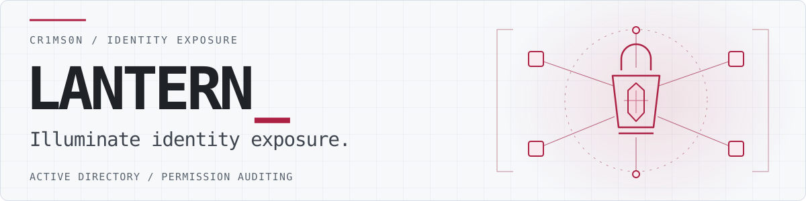

<picture>
  <source media="(prefers-color-scheme: dark)" srcset="assets/banner-dark.svg">
  <source media="(prefers-color-scheme: light)" srcset="assets/banner-light.svg">
  
</picture>

# Lantern (ACLGuard)

**Active Directory permission auditing. Read-only, terminal-first, inspectable.**

Query directory users over LDAP, flag high-risk group memberships, and review ATT&CK-mapped findings with a 0–100 risk score. Use the offline fixtures to explore the CLI without a directory or credentials.

[Quick start](#quick-start) · [Usage guide](docs/USAGE.md) · [Architecture](ARCHITECTURE.md) · [Security](SECURITY.md)

## What ships today

This repository ships **ACLGuard, C v2.0.0 “Purple”**. **Lantern** is the codename for the planned Go rewrite, not a second working binary.

| Available now | Planned, not implemented |
| --- | --- |
| Read-only LDAP user and direct group enumeration | Go CLI and interactive TUI |
| Group-name permission heuristics and weighted risk scores | Raw DACL/ACE parsing and effective-rights analysis |
| ATT&CK mapping, CLI JSON, legacy JSON/CSV export | Queryable permission graph and transitive paths |
| Offline mock fixtures and shell smoke tests | Static binary and downstream integration contracts |

The C build links OpenLDAP and JSON-C. It is not the planned static Go binary described in the [target architecture](ARCHITECTURE.md#2-lantern-go-target).

## Quick start

From the repository root, with GCC, Make, OpenLDAP and JSON-C development headers installed:

```bash
make clean && make
./aclguard --mock status
./aclguard --mock alerts --recent --json
```

No AD server, credentials, or network connection is needed for mock commands. Run them from the repository root so the CLI can find `data/mock/`.

```bash
# Exercise the other offline views
./aclguard --mock correlate --attack kerberoasting
./aclguard --mock analyze --incident latest
./aclguard --mock metrics --throughput
```

For package installation, directory configuration, output examples, and the full command reference, see the [usage guide](docs/USAGE.md). To build and run the existing smoke tests:

```bash
make test
```

The live LDAP smoke test skips when directory credentials are absent. The offline test also runs the bundled alert simulation, which can update mock fixtures.

## Read the findings, know the boundary

ACLGuard highlights group-name signals for admin membership, password resets, ACL modification, delegation, service accounts, and secret access. These are **review leads, not proof of effective permissions or exploitable paths**.

- Direct memberships only; no nested-group or cross-domain path resolution.
- No raw ACE parsing, Entra ID support, or automatic remediation.
- Plain LDAP baseline; LDAPS/GSSAPI support remains planned.

Use a least-privilege, read-only bind account only in an authorized, trusted lab or protected network. The current `ldap://` path sends credentials in cleartext; read the [security policy](SECURITY.md) before a live run. Keep real directory findings private and anonymize published evidence.

## Explore the project

| Start here | What you will find |
| --- | --- |
| [Usage guide](docs/USAGE.md) | Installation, CLI, configuration, exports, ATT&CK mappings |
| [Architecture](ARCHITECTURE.md) | Current C implementation and the separately marked Go target |
| [Contributing](CONTRIBUTING.md) | Development conventions and contribution workflow |
| [Changelog](CHANGELOG.md) | Recorded release history |
| [Security policy](SECURITY.md) | Credential handling, data boundaries, private disclosure |
| [Agent guidance](AGENTS.md) | Repository rules for coding agents |

<details>
<summary>Historical documentation</summary>

[README v1.0](README_v1.0.md) and the [wiki source](wiki/) are retained as historical material. They may describe older behavior; use the current usage guide and source for the working CLI.

</details>

## Part of the same system

Lantern focuses on **identity exposure**: turning directory observations into reviewable evidence. Its place alongside the workstation, orchestration, and research projects is described in the [integration targets](docs/INTEGRATIONS.md); those connections are planned, not shipped integrations.

| Project | Role |
| --- | --- |
| [NightForge](https://github.com/CR1MS0N-Operator/nightforge) | The operator workstation and validation environment |
| [C4](https://github.com/CR1MS0N-Operator/c4) | Infrastructure lifecycle orchestration |
| [Security research](https://github.com/CR1MS0N-Operator/security-research) | Raw research and reproducible technical evidence |
| [Azrael Security](https://azraelsecurity.vercel.app) | Public portfolio and research presentation |

---

<sub>[CR1MS0N-Operator](https://github.com/CR1MS0N-Operator) · Inspectable tooling. Evidence before claims. · [MIT license](LICENSE)</sub>
